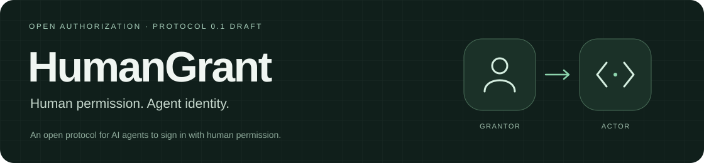

<p align="center"></p>

<p align="center">One link. A human signs in. The agent continues.</p>

<p align="center"><strong>English</strong> · <a href="README.zh-CN.md">简体中文</a></p>

<p align="center"><a href="https://github.com/LIghtJUNction/humangrant/actions/workflows/ci.yml"></a></p>

HumanGrant gives an AI agent a login link to share with a person. The person opens it, uses their existing account, and confirms access. The agent receives its own limited session and continues the task.

The normal website has no HumanGrant login button or request console. Agents discover the flow through `/.well-known/humangrant.json`, `/agent.md`, and a machine-readable link in the page header. The dedicated human link is the only sign-in surface.

## Add to your project

Give your coding agent this instruction:

<!-- BEGIN HUMANGRANT INTEGRATION PROMPT -->

```text
Read https://github.com/LIghtJUNction/humangrant/blob/main/skills/humangrant-integrate/SKILL.md and add HumanGrant to this project.
```

<!-- END HUMANGRANT INTEGRATION PROMPT -->

Keep your existing account system. [The integration guide](docs/integration.md) explains how to reuse its server-verified login and issue a separate agent session.

## Run the example

With Rust and Python installed:

```sh
git clone https://github.com/LIghtJUNction/humangrant.git
cd humangrant
python -m venv .venv
. .venv/bin/activate
python -m pip install -r requirements-dev.txt
python examples/setup_demo.py --dir .state
cargo run -- serve .state/config.json
```

In another terminal, create the link:

```sh
python clients/humangrant.py --local discover
python clients/humangrant.py --local --key .state/ai.key.json request --purpose "Read one note" --permissions notes.read:alice-note --expected-human alice
```

Share the returned `human_authorization_url`. The person completes sign-in in their own browser. Use the returned request ID to wait and claim the agent session:

```sh
python clients/humangrant.py --local --key .state/ai.key.json status "$REQUEST_ID" --watch --session-out .state/ai-session.json
```

The notes resource is a small integration example for checking that session access works.

## Reference

| Resource | Purpose |
| --- | --- |
| [Integration skill](skills/humangrant-integrate/SKILL.md) | Add discovery and login links to an existing application. |
| [Client skill](skills/humangrant-use/SKILL.md) | Generate a link, wait for the human, and continue. |
| [Example walkthrough](examples/README.md) | Run the complete local flow. |
| [Protocol](spec/v0.1.md) · [OpenAPI](openapi.yaml) | Request, status, authentication, and session contracts. |
| [Deployment](docs/deployment.md) · [Security](SECURITY.md) | Configure an origin and protect the account boundary. |

---

[Contributing](CONTRIBUTING.md) · [MIT License](LICENSE)
