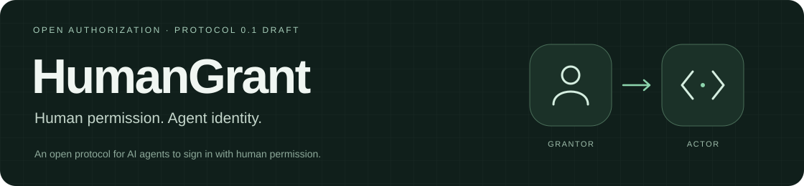

<p align="center"></p>

<p align="center">An open protocol for AI agents to sign in with human permission.</p>

<p align="center"><strong>English</strong> · <a href="README.zh-CN.md">简体中文</a></p>

<p align="center">
  <a href="https://github.com/LIghtJUNction/humangrant/actions/workflows/ci.yml"></a>
  <a href="spec/v0.1.md"></a>
  <a href="Cargo.toml"></a>
  <a href="migrations/0001.sql"></a>
  <a href="openapi.yaml"></a>
  <a href="skills/"></a>
  <a href="LICENSE"></a>
</p>

<p align="center"><a href="spec/v0.1.md">Protocol</a> · <a href="openapi.yaml">API</a> · <a href="examples/README.md">Examples</a> · <a href="docs/integration.md">Integration</a></p>

## Add to your project

<p align="center">
  <a href="skills/humangrant-integrate/SKILL.md">
    <picture>
      <source media="(prefers-color-scheme: dark)" srcset="assets/continue-with-human-beings-dark.svg">
      
    </picture>
  </a>
</p>

<!-- BEGIN HUMANGRANT INTEGRATION PROMPT -->

```text
Read https://github.com/LIghtJUNction/humangrant/blob/main/skills/humangrant-integrate/SKILL.md and add HumanGrant to this project.
```

<!-- END HUMANGRANT INTEGRATION PROMPT -->

## How it works

**Request → Approve → Act**

The agent sends you a link or email invitation. You open it on your device and choose the actions and resources it can use. The agent continues with its own identity. You can revoke access at any time.

## Run locally

With Rust and Python installed:

```sh
git clone https://github.com/LIghtJUNction/humangrant.git
cd humangrant
python -m venv .venv
. .venv/bin/activate
python -m pip install -r requirements-dev.txt
python examples/setup_demo.py --dir .state
cargo run -- serve .state/config.json
```

Open <http://127.0.0.1:8787>. Follow the [full example](examples/README.md) to connect an agent and read a note, or see [deployment](docs/deployment.md) for a remote server.

## Agent skills

| Skill | Use it to |
| --- | --- |
| [humangrant-integrate](skills/humangrant-integrate/SKILL.md) | Add HumanGrant to an existing project. |
| [humangrant-use](skills/humangrant-use/SKILL.md) | Request permission and continue a task. |

Give your agent a skill link, or copy the skill's folder into your client's skill directory.

---

[Contributing](CONTRIBUTING.md) · [MIT License](LICENSE)
