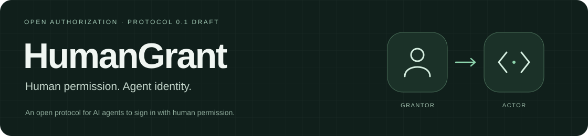

<p align="center"></p>

<p align="center">AI 发一个链接，人类完成登录，任务继续。</p>

<p align="center"><a href="README.md">English</a> · <strong>简体中文</strong></p>

<p align="center"><a href="https://github.com/LIghtJUNction/humangrant/actions/workflows/ci.yml"></a></p>

HumanGrant 只做一件事：让 AI 生成登录链接，交给人类代登录。人类打开链接，使用已有账户并确认访问，AI 获得自己的受限会话，继续完成任务。

普通网页不展示 HumanGrant 登录按钮或请求控制台。AI 通过 `/.well-known/humangrant.json`、`/agent.md` 和页面头部的机器可读链接发现入口。人类只在收到的专用链接里完成登录。

## 让 AI 为你的项目接入 HumanGrant

把下面这句话发给开发助手：

<!-- BEGIN HUMANGRANT INTEGRATION PROMPT -->

```text
请按 https://github.com/LIghtJUNction/humangrant/blob/main/skills/humangrant-integrate/SKILL.md 为当前项目接入 HumanGrant。
```

<!-- END HUMANGRANT INTEGRATION PROMPT -->

保留项目已有的账户与登录方式。[接入指南](docs/integration.md) 说明如何复用服务端验证过的登录状态，并为 AI 签发独立会话。

## 运行示例

准备 Rust 和 Python 后执行：

```sh
git clone https://github.com/LIghtJUNction/humangrant.git
cd humangrant
python -m venv .venv
. .venv/bin/activate
python -m pip install -r requirements-dev.txt
python examples/setup_demo.py --dir .state
cargo run -- serve .state/config.json
```

在另一个终端生成链接：

```sh
python clients/humangrant.py --local discover
python clients/humangrant.py --local --key .state/ai.key.json request --purpose "Read one note" --permissions notes.read:alice-note --expected-human alice
```

把返回的 `human_authorization_url` 发给人类。人类在自己的浏览器里完成登录。将返回的请求 ID 用于等待和领取会话：

```sh
python clients/humangrant.py --local --key .state/ai.key.json status "$REQUEST_ID" --watch --session-out .state/ai-session.json
```

示例里的笔记资源用于验证会话确实可以访问获准内容。

## 文档

| 文档 | 用途 |
| --- | --- |
| [接入技能](skills/humangrant-integrate/SKILL.md) | 为现有应用增加 AI 发现入口和登录链接。 |
| [使用技能](skills/humangrant-use/SKILL.md) | 生成链接，等待人类登录，然后继续任务。 |
| [完整示例](examples/README.md) | 跑通本地登录流程。 |
| [协议](spec/v0.1.md) · [OpenAPI](openapi.yaml) | 请求、状态、身份验证和会话接口。 |
| [部署](docs/deployment.md) · [安全边界](SECURITY.md) | 配置服务地址并保护账户身份。 |

---

[参与贡献](CONTRIBUTING.md) · [MIT 许可证](LICENSE)
